

<picture><source media="(max-width: 640px)" srcset="images/header-phone.svg?v=9"></picture>

<picture>
  <source media="(prefers-color-scheme: dark)" srcset="images/synthwave-divider.svg">
  
</picture>

### 👨‍💻 About

**Principal Solutions Engineer** working where AI meets security. I help enterprises adopt agentic AI-assisted development without losing control of their risk posture.

- **Securing agentic AI in production:** agent and MCP workflows, plus the guardrails and safety directives that let teams ship *faster* with AI, not slower.
- **Building the tooling that makes it real:** security scanners for MCP servers and AI agents, OWASP standards shipped as Claude Code skills, and end-to-end secure CI/CD pipelines.
- **Two decades of B2B solutions engineering:** discovery that finds the real business problem, value proven in the customer's own context, and architecture that survives production.

> *AI writes the code, security checks every line.*

<picture>
  <source media="(prefers-color-scheme: dark)" srcset="images/synthwave-divider.svg">
  
</picture>

### 🛠️ Featured Work

**🛡️ Security tooling for the agentic-AI era**

<a href="https://github.com/markusweldon/cverdict">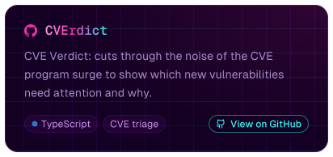</a>

<a href="https://github.com/markusweldon/agentinel">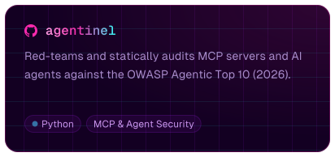</a>
<a href="https://github.com/markusweldon/claude-owasp-security-skills">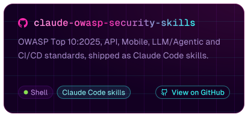</a>

<a href="https://github.com/markusweldon/claude-snyk-security-expert">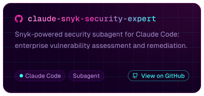</a>

<picture>
  <source media="(prefers-color-scheme: dark)" srcset="images/synthwave-divider.svg">
  
</picture>

### ⚡ Activity

<picture>
  <source media="(prefers-color-scheme: dark)" srcset="images/synthwave-divider.svg">
  
</picture>

### 🔥 Streaks


<picture>
  <source media="(prefers-color-scheme: dark)" srcset="images/synthwave-divider.svg">
  
</picture>

### 📊 Stats

<picture>
  <source media="(prefers-color-scheme: dark)" srcset="images/synthwave-divider.svg">
  
</picture>

### 🎯 Focus Areas

<picture><source media="(max-width: 640px)" srcset="images/focus-agentic-ai-security-wide.svg">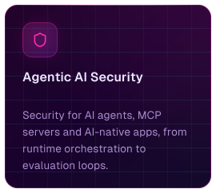</picture>
<picture><source media="(max-width: 640px)" srcset="images/focus-secure-ai-development-wide.svg">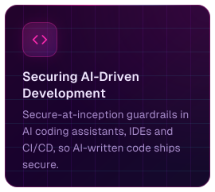</picture>
<picture><source media="(max-width: 640px)" srcset="images/focus-enterprise-ai-strategy-wide.svg">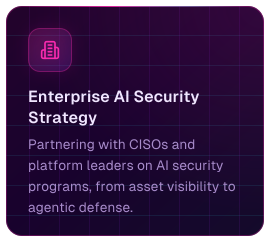</picture>

<picture>
  <source media="(prefers-color-scheme: dark)" srcset="images/synthwave-divider.svg">
  
</picture>

### 🧰 Stack

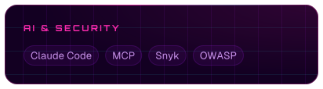
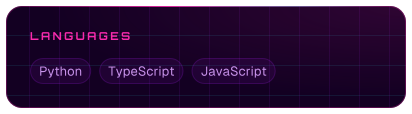

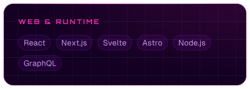
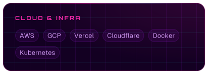

<picture>
  <source media="(prefers-color-scheme: dark)" srcset="images/synthwave-divider.svg">
  
</picture>

### 💻 Workspace

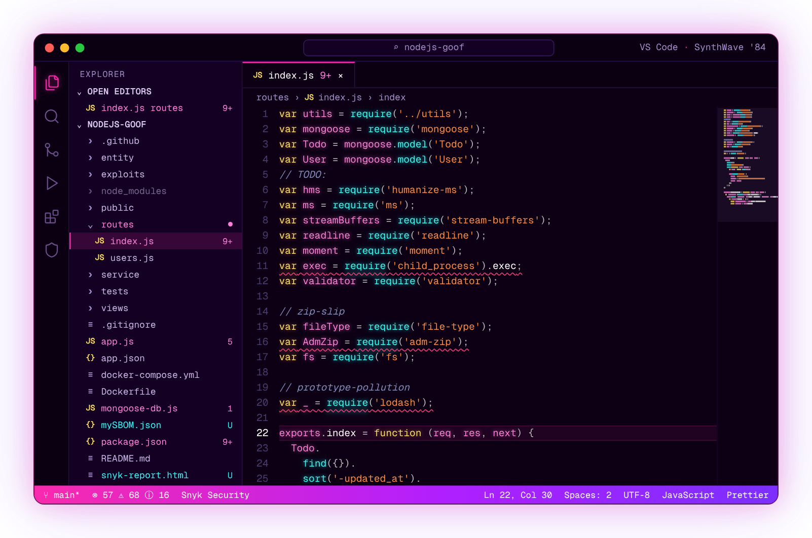 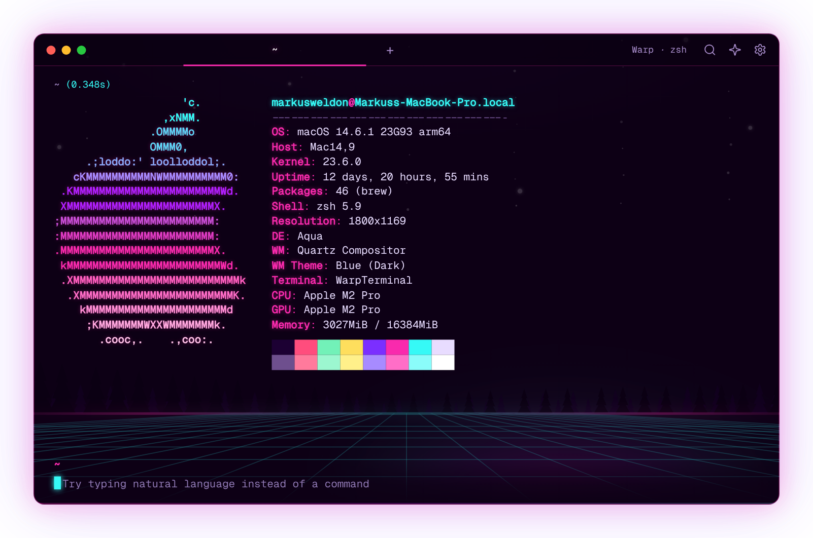

Car model: "Tesla roadster" by Delta Xeon on Sketchfab, <a href="https://creativecommons.org/licenses/by/4.0/">CC BY 4.0</a>

